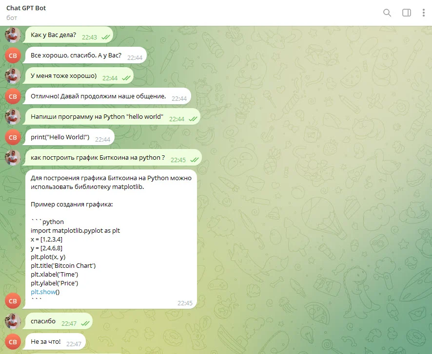

# chat_gpt_telegram_bot

Ранний прототип Telegram-бота с ответами через OpenAI и простым эхо-режимом.

**Python-портфолио Евгения Толмачева** · Начало: 2022 · Python · Telegram Bot API · OpenAI API



## Возможности

- Приём сообщений пользователя в Telegram.
- Запрос ответа у языковой модели.
- Простой эхо-бот как начальный вариант.

## Что смотреть в коде

Обработка сообщений Telegram, HTTP-запрос к OpenAI и разделение генерации ответа и обработчика сообщений.

Начните с `chat_gpt_telegram_bot.py`. Названия авторских файлов и их расположение сохранены.

## Структура

```text
chat_gpt_telegram_bot/
├── docs/
│   └── preview.webp
├── .env.example
├── .gitignore
├── chat_gpt_telegram_bot.py
├── README.md
├── README.public.md
└── requirements.txt
```

## Подготовка и запуск

Это сохранённая версия пет-проекта, показывающая этап развития навыков. Для воспроизведения создайте отдельное окружение Python, совместимое с зафиксированными зависимостями:

```powershell
python -m venv .venv
.venv\Scripts\Activate.ps1
python -m pip install -r requirements.txt
```

Задайте OPENAI_API_KEY, TELEGRAM_BOT_TOKEN и TELEGRAM_ALLOWED_USER_ID (числовой ID пользователя, которому бот разрешает отвечать). Для запуска нужны собственный Telegram-бот и доступ к используемой в коде модели/API.

Переменные окружения: `OPENAI_API_KEY`, `TELEGRAM_BOT_TOKEN`. Образец находится в [.env.example](.env.example). Сам файл .env автоматически не загружается: исходники читают окружение процесса. Значения нужно передать перед запуском, например в PowerShell:

```powershell
$env:OPENAI_API_KEY = "YOUR_VALUE"
```

После подготовки настроек и необходимых данных основная точка входа:

```powershell
python chat_gpt_telegram_bot.py
```

`requirements.txt` сохранён из проекта. Это снимок окружения, а не гарантия совместимости с новейшей версией Python. Для старых проектов могут потребоваться соответствующая версия Python и настройка системных компонентов.

## История и состав публикации

Ранний проект: исходные версии относятся к декабрю 2022. В каталоге показан код из текущей основной директории.

В репозитории оставлены авторские исходники, зависимости и один компактный скриншот. Виртуальные окружения, сторонние библиотеки, рабочие базы, модели, большие наборы данных и персональные настройки не включены.

Чувствительные значения заменены понятными заглушками `YOUR_...` / `REDACTED_...`. Настоящие доступы не следует добавлять в Git. Алгоритмы и структура проекта при подготовке публикации не перерабатывались.

Проверена синтаксическая корректность Python-файлов и выполнено сканирование публикуемой копии на секреты. Полный запуск с внешними API, платежами, биржевыми операциями и локальными моделями не выполнялся.

Автор: [Евгений Толмачев](https://github.com/EvgenyET) · [Портфолио](https://evgeny.tech/)
